<p align="center">
  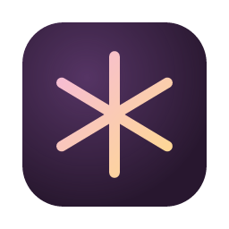
</p>

<h1 align="center">Muse</h1>

<p align="center">
  A music player and recommender for the music folders you already have.<br>
  No account, no server. It runs on your computer and only your computer can reach it.
</p>

<table>
  <tr>
    <td width="33%"><picture>
      <source media="(prefers-color-scheme: dark)" srcset="docs/readme/hero-1-dark.jpg">
      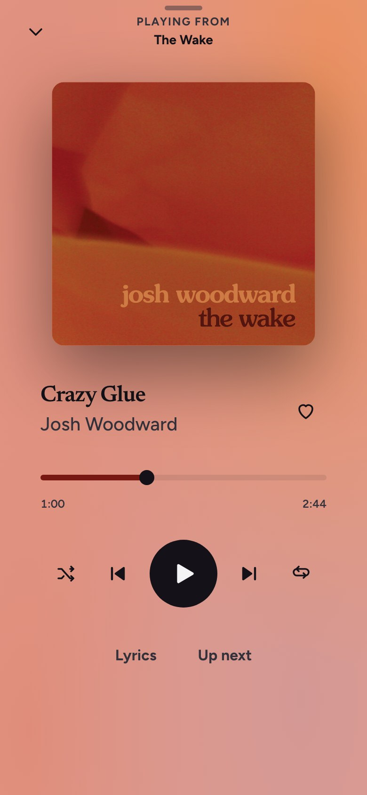
    </picture></td>
    <td width="33%"><picture>
      <source media="(prefers-color-scheme: dark)" srcset="docs/readme/hero-2-dark.jpg">
      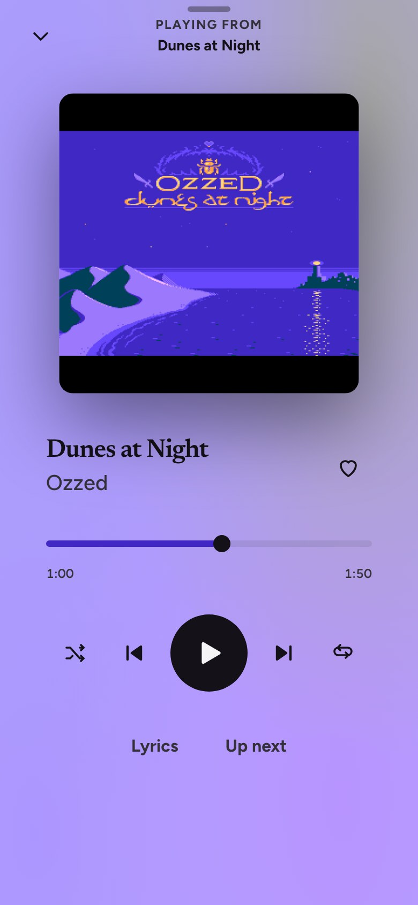
    </picture></td>
    <td width="33%"><picture>
      <source media="(prefers-color-scheme: dark)" srcset="docs/readme/hero-3-dark.jpg">
      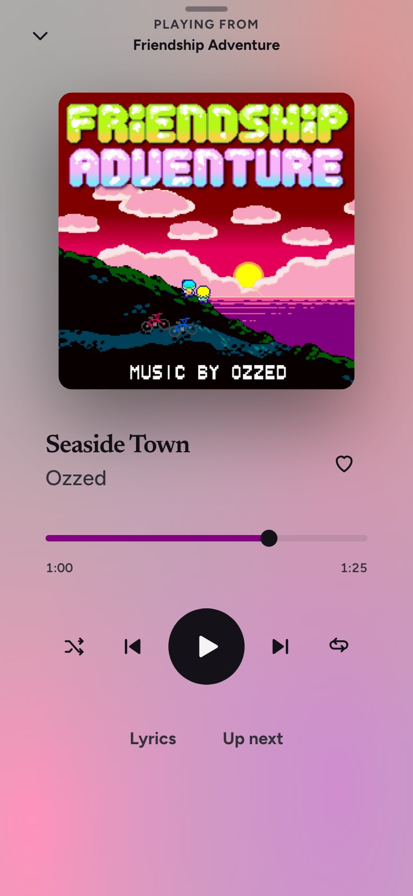
    </picture></td>
  </tr>
</table>

<p align="center"><sub>The window takes its colours from the cover of the song that is playing.</sub></p>

Muse plays the folders you point it at, picks what to play next from how
songs sound and what their lyrics say, shows lyrics in time with the song and
finds missing covers. It never writes to your music folders, except when you
choose Move to Trash.

Status: alpha.

## Install

Download the installer for your system from
[GitHub Releases](../../releases). The builds are unsigned, so the first
launch needs one extra step:

- **macOS:** right-click the app and choose Open.
- **Windows:** in the SmartScreen warning choose More info, then Run anyway.

Then add your music folders in Settings. Muse scans them at launch and
watches them for changes.

## A look around

<p align="center">
  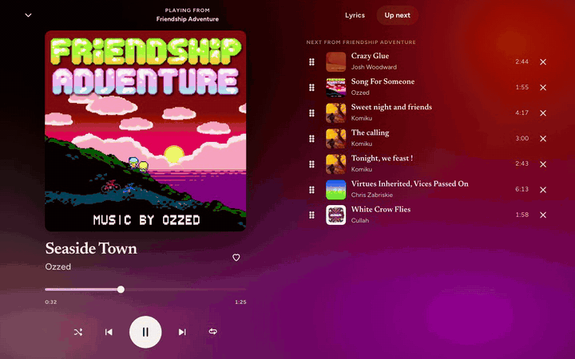
</p>

<table>
  <tr>
    <td width="50%" valign="top"><picture>
      <source media="(prefers-color-scheme: dark)" srcset="docs/readme/library-dark.jpg">
      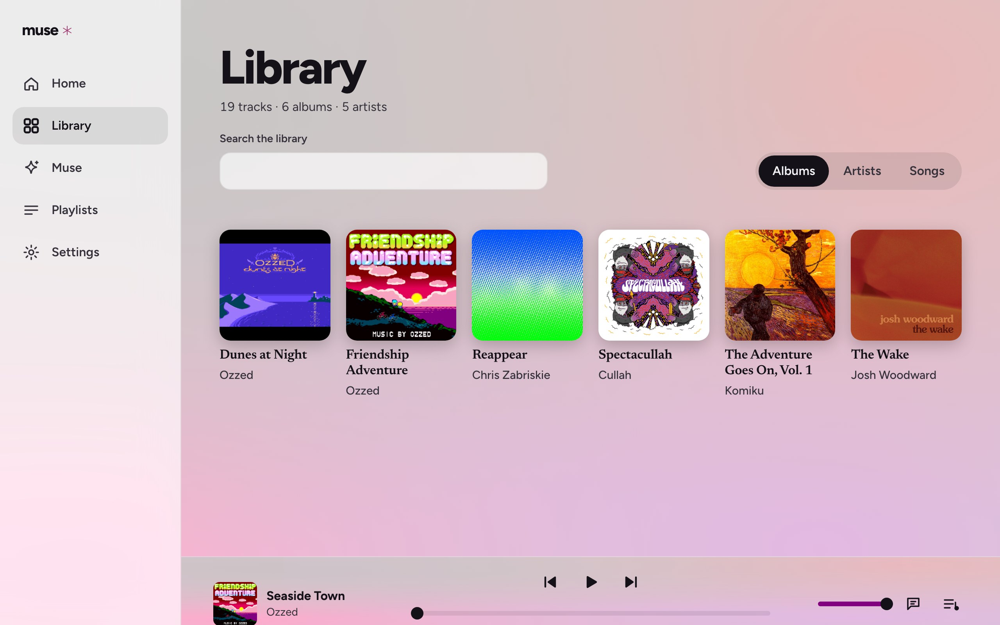
    </picture>
    <b>Library.</b> Albums as a gallery of covers; songs and tracklists stay plain rows.</td>
    <td width="50%" valign="top"><picture>
      <source media="(prefers-color-scheme: dark)" srcset="docs/readme/lyrics-dark.jpg">
      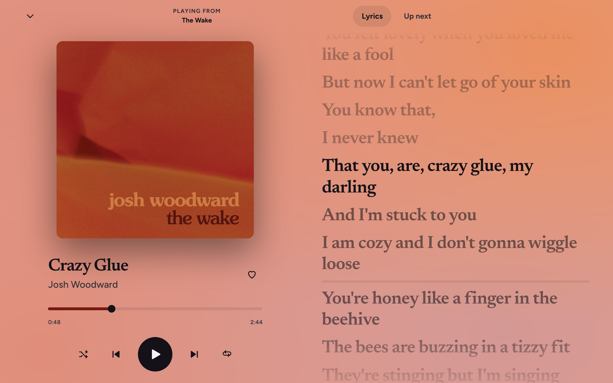
    </picture>
    <b>Lyrics.</b> Lyrics follow the song line by line. No timings yet? Tap along, or let Muse time them.</td>
  </tr>
  <tr>
    <td width="50%" valign="top"><picture>
      <source media="(prefers-color-scheme: dark)" srcset="docs/readme/radio-dark.jpg">
      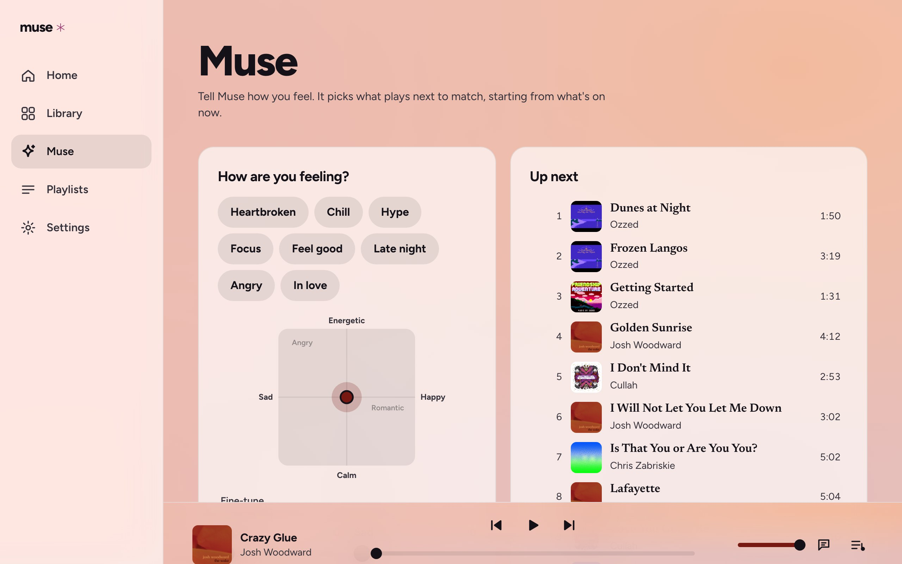
    </picture>
    <b>Radio.</b> Start from any song; Muse keeps choosing the next one.</td>
    <td width="50%" valign="top"><picture>
      <source media="(prefers-color-scheme: dark)" srcset="docs/readme/edit-dark.jpg">
      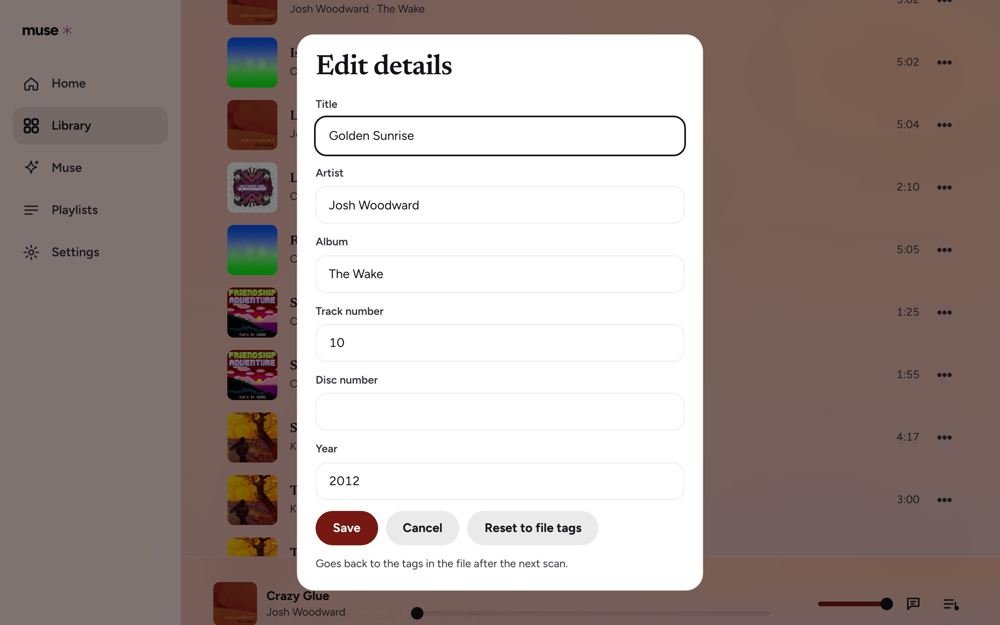
    </picture>
    <b>Edits.</b> Fix titles, artists and covers. Your files are never changed.</td>
  </tr>
  <tr>
    <td colspan="2" align="center"><picture>
      <source media="(prefers-color-scheme: dark)" srcset="docs/readme/mini-dark.jpg">
      
    </picture><br>
    <b>Mini player.</b> A small always-on-top window with the cover and controls.</td>
  </tr>
</table>

Closing the window keeps Muse playing in the tray (the menu bar on macOS), with
Play/Pause, Next, Mini player, Show Muse and Quit Muse. Drag a folder onto the
window to watch it, or a song to add it in place.

## How Radio picks the next song

With smart features installed, Muse listens to each song and reads its lyrics,
on your computer. Each kind of evidence is a leg; each leg's similarity is
put on the same scale before they are added up, so a song missing a leg (an
instrumental has no lyrics) is not pushed down for it.

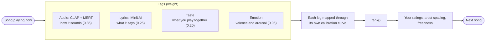

The fifth weight, Spotify-style audio features (0.15), has no data in this
app and drops out. Without smart features, Radio still works from your play
history. Details: [ADR 0003](docs/adrs/0003-emotion-and-taste-legs-in-the-recommender.md),
[ADR 0008](docs/adrs/0008-per-leg-calibration-and-the-offline-harness.md).

## Smart features

An optional download (about 5 GB; the banner shows the exact size) that
powers Radio's listening, vibe search, lyric tags and lyric timing. Install it
from the banner or Settings > Smart features. Files are checked against a
hash list, and a dropped download resumes where it stopped. Nothing leaves
your computer except the download.

- **Auto-align** times a song's lyrics to its audio when you ask (a song's
  More menu or its lyrics panel): English with the schufo aligner, other
  languages with MMS-FA. It writes an `.lrc` in Muse's data folder.
- **Tap along:** play the song and tap (or press Space) as each line starts.
- **Not supported:** Intel Macs (PyTorch ships no wheel for them) and Linux.

## Your library and your files

Edits live in Muse's own database. Reset to file tags drops them.

- **Remove** hides a song and keeps its play history. **Also move to Trash**
  sends the file to your system Trash as well; plain Remove never deletes a
  file. Restore removed songs in Settings > Removed songs.
- **Hidden artists** leave the Artists list; their albums and songs still show.
- **Covers and artist pictures:** upload a JPEG, PNG or WebP (up to 10 MB). An
  uploaded cover is never replaced by the automatic cover fetch.
- **Lyrics:** edit from a song's More menu. If the song had timings, you
  choose to keep or remove them.

Everything Muse writes goes in one data folder:

| | |
|---|---|
| macOS | `~/Library/Application Support/io.github.ianthemitten.muse` |
| Windows | `%LOCALAPPDATA%\io.github.ianthemitten.muse` |
| Linux | `~/.local/share/io.github.ianthemitten.muse` |

<details>
<summary>What is in it</summary>

- `library.sqlite3`: tracks, plays, ratings, jobs
- `lyrics/`: `.txt` and `.lrc` files keyed by track id
- `art/`: album and artist images
- `settings.json`: your music folders and any songs you dropped in
- `muse.log`: the server's log; when Muse can't start, the start screen shows
  its last lines and the path
- `downloads/`: songs Muse saves for you, scanned like a music folder
- `models/`: smart features (`weights/`, `worker/`, `installed.json`)

`MUSE_DATA_DIR` overrides the location.
</details>

## For developers

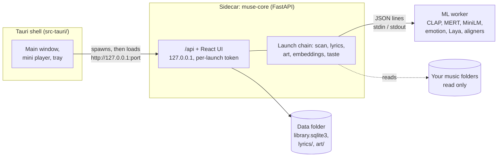

One FastAPI process serves the UI and the API on loopback; the Tauri shell
wraps it in a native window. Every model runs in the separate worker process,
so the app itself never imports PyTorch.

Run it from source (Python 3.12 with [`uv`](https://docs.astral.sh/uv/), Node 22):

```sh
uv sync
cd web && npm ci && npm run build && cd ..
uv run python -m muse
```

Open the `http://127.0.0.1:<port>/?t=<token>` URL it logs. Tests:
`uv run pytest` and `cd web && npm test`.

- Desktop shell, the worker, env vars, all tests: [docs/DEVELOPING.md](docs/DEVELOPING.md)
- Releasing the app and the worker: [docs/RELEASING.md](docs/RELEASING.md)
- Architecture and commands: [CLAUDE.md](CLAUDE.md) · Glossary: [CONTEXT.md](CONTEXT.md)
- Product voice: [PRODUCT.md](PRODUCT.md) · Decisions: [docs/adrs/](docs/adrs/)

## Licenses

Muse's own code is licensed under the [PolyForm Noncommercial License 1.0.0](LICENSE).
Muse is free and for non-commercial use. The music in the screenshots is
listed with its licences in [docs/readme/CREDITS.md](docs/readme/CREDITS.md).

<details>
<summary>Models and components</summary>

Smart features download models that are free for non-commercial use only:

- MERT-v1-95M (CC-BY-NC-4.0)
- audeering wav2vec2 emotion model (CC-BY-NC-SA-4.0)
- MMS-FA aligner (CC-BY-NC-4.0)
- schufo aligner, trained on MUSDB18 (`other-nc`)

Other models and components:

- CLAP larger_clap_music_and_speech (Apache-2.0)
- all-MiniLM-L6-v2 (Apache-2.0)
- j-hartmann emotion-english-distilroberta-base: its model card states no licence
- Laya, `convaiinnovations/laya` and the finetune built on it (Apache-2.0)
  (downloaded from the owner's Hugging Face repo)
- PyAV decodes audio. PyAV is BSD; its wheels bundle FFmpeg's LGPL libraries.
- The asterisk in the logo is Phosphor's (MIT).
- MMS-FA is `MahmoudAshraf/mms-300m-1130-forced-aligner`, from Meta's MMS
- schufo lyrics-aligner (MIT). Schulze-Forster et al., 2021, TASLP 29:2382-2395.
  It was trained on MUSDB18 and its lyrics extension, both licensed
  non-commercial (Zenodo 1117372 and 3989267).
- CMU Pronouncing Dictionary (BSD-style)
- g2p_en GRU weights (Apache-2.0)
- uroman (see below)
- py3langid (BSD-3)

This project uses the universal romanizer software 'uroman' written by Ulf
Hermjakob, USC Information Sciences Institute (2015-2020).
</details>
